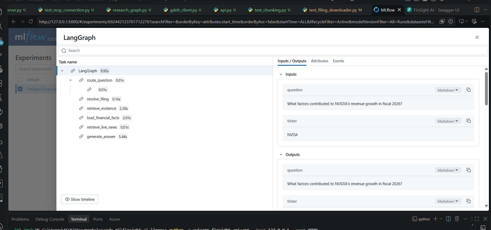
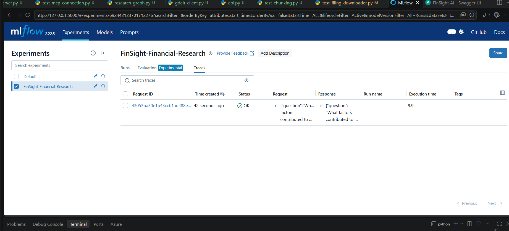

# FinSight AI — Financial Research & LLMOps

[](https://github.com/SarathKumarKomathukattil/finsight-ai-llmops/actions/workflows/ci.yml)

An evidence-backed financial research application built with **Python, FastAPI, LangGraph, MCP, SEC EDGAR/XBRL, PostgreSQL/pgvector, Sentence Transformers, Ollama and MLflow**.

## What it does

- Ingests and parses real SEC filings with source provenance and checksums.
- Retrieves and reranks relevant filing passages for financial RAG.
- Calculates annual revenue comparisons from structured SEC XBRL facts (not LLM arithmetic).
- Orchestrates SEC research and optional news retrieval through LangGraph and MCP tools.
- Uses GDELT for recent news, with Google News RSS fallback.
- Returns structured answers and original SEC citations through `POST /research`.
- Captures LangGraph execution traces in MLflow.

**Current scope:** NVIDIA (NVDA), local inference and local database. Kafka, Airflow, AKS, KEDA, vLLM and AIOps are planned infrastructure extensions, not implemented production services.

## Demonstrated result

For “What factors contributed to NVIDIA's revenue growth in fiscal 2026?” the application returned FY2026 revenue of **$215.938B**, FY2025 revenue of **$130.497B**, and **65.47%** year-over-year growth with sources:

- [SEC XBRL company facts](https://data.sec.gov/api/xbrl/companyfacts/CIK0001045810.json)
- [NVIDIA FY2026 10-K](https://www.sec.gov/Archives/edgar/data/1045810/000104581026000021/nvda-20260125.htm)

Local validation on November 13, 2026: **24 pytest tests passed**. A successful MLflow trace recorded **9.93 seconds** end-to-end in one run. These are local results, not cloud CI benchmarks.

## Run locally

Requires Python 3.12, configured PostgreSQL/pgvector, a running Ollama instance with the project's configured LLM, and the application environment variables. Copy `.env.example` to `.env`, supply your actual SEC identity, PostgreSQL credentials and installed Ollama model, then install the project's dependencies from `requirements.txt`. The full dependency file is currently a snapshot of the original Windows/CUDA environment; `requirements-ci.txt` is the portable offline test subset.

```powershell
python -m mlflow server --host 127.0.0.1 --port 5000
```

In a second terminal:

```powershell
python -m uvicorn finsight.api:app --host 127.0.0.1 --port 8000
```

Open [FastAPI Swagger UI](http://127.0.0.1:8000/docs), then call `POST /research`:

```json
{
  "question": "What factors contributed to NVIDIA's revenue growth in fiscal 2026?",
  "ticker": "NVDA"
}
```

Run the existing tests with:

```powershell
python -m pytest tests/ -q
```

### CI

The [GitHub Actions workflow](.github/workflows/ci.yml) installs `requirements-ci.txt`, checks Python syntax and runs offline pytest tests on Python 3.12. [CI run #3 passed](https://github.com/SarathKumarKomathukattil/finsight-ai-llmops/actions/runs/43300974907). The SEC live integration test is excluded from CI to avoid external network dependence.

## Demonstration screenshots

The following screenshots were recorded from a successful local LangGraph research run. Copy the images into `docs/images/` to make the previews visible in GitHub.

**MLflow trace:** `docs/images/mlflow-trace.png`



**MLflow tracing dashboard:** `docs/images/mlflow-dashboard.png`



## Benchmark results (local runs, November 13, 2026)

### SEC retrieval

Three hand-labeled NVIDIA questions covering revenue growth, supply-chain risk and export restrictions:

| Metric | Observed score |
|---|---:|
| Hit@10 | 1.0000 (100%) |
| MRR@10 | 1.0000 |
| nDCG@10 | 0.8591 |
| Number of questions | 3 |

Embedding model: `BAAI/bge-small-en-v1.5`. Reranker: `BAAI/bge-reranker-base`.

### End-to-end financial research regression

One question about NVIDIA FY2026 revenue growth, evaluated through the existing FastAPI endpoint:

| Metric | Observed score |
|---|---:|
| Correct response status | 1/1 |
| Expected financial strings present | 4/4 |
| Citation metadata check | Passed |
| Wall-clock request latency | 23.59 seconds |

These are **small baselines**, not estimates of general QA accuracy. The financial check tests expected values appearing in the answer, not complete numeric reasoning, and citation metadata validation does not prove claim-level groundedness. The 23.59-second latency is one local observation, not a median or load test.

**Reproduce:** Start FastAPI and MLflow on ports 8000 and 5000, then run:

```powershell
python -m finsight.evaluate_retrieval
python -m finsight.evaluate_research
```

Both evaluation scripts log metrics and run artifacts to MLflow. See `finsight/eval_cases.json` for the three retrieval questions and their labeled evidence IDs.

**Benchmark screenshots:** `docs/images/retrieval-benchmark.png` and `docs/images/research-benchmark.png` (add these image files to the repository to enable previews).

## Engineering notes

Financial figures originate from SEC facts, not model-generated calculations. SEC narrative claims are cited to filing passages. Live news is metadata, not independently verified article content. The repository is a research engineering demonstration, not a trading or personalized investment-advice service.

## Roadmap

Kafka event ingestion, Airflow reconciliation DAGs, MLflow evaluation gates, Docker and Kubernetes, Azure AKS/Terraform, vLLM serving, KEDA autoscaling, Prometheus/Grafana and operational AIOps.

See [LICENSE](LICENSE).
